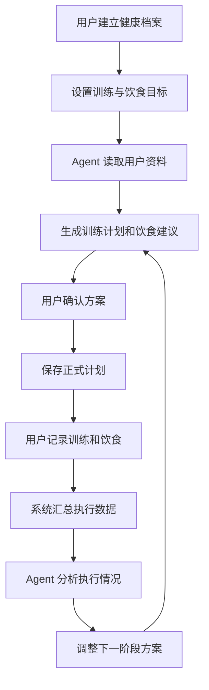
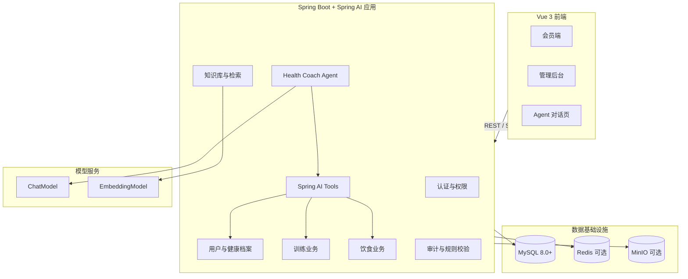
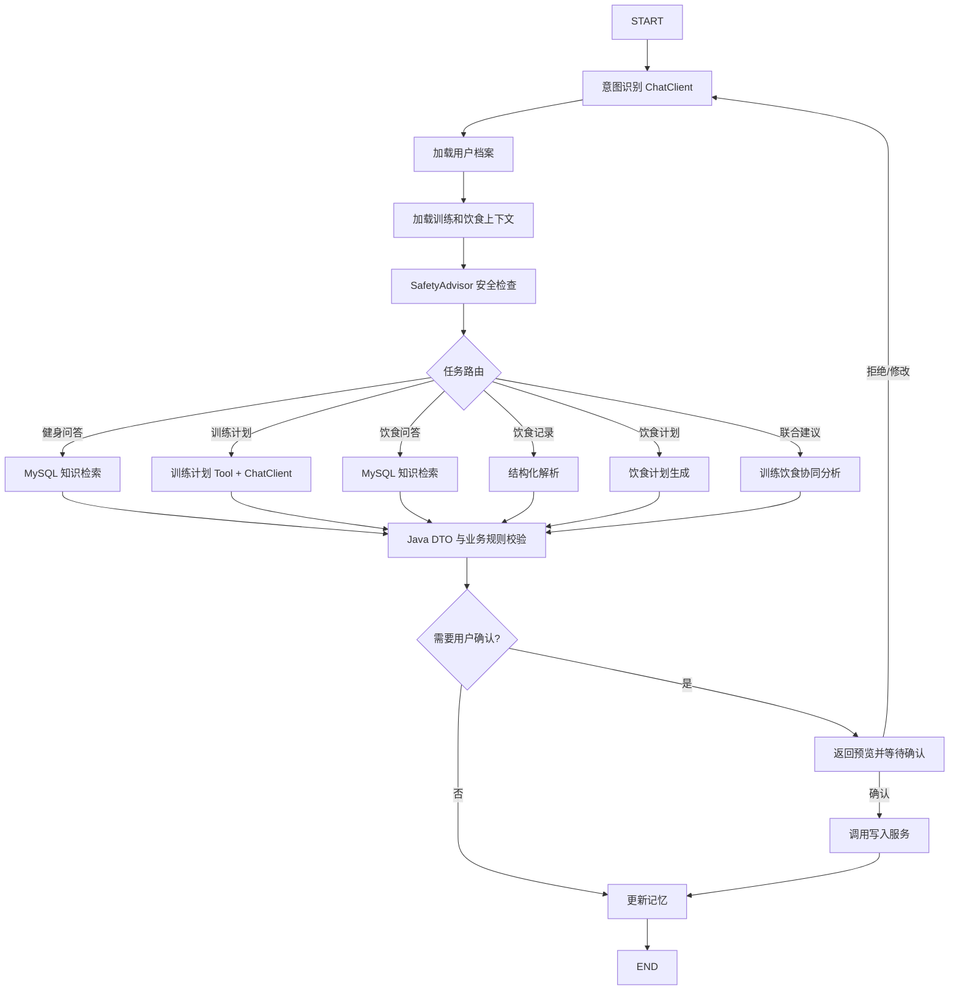
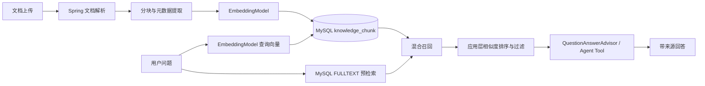
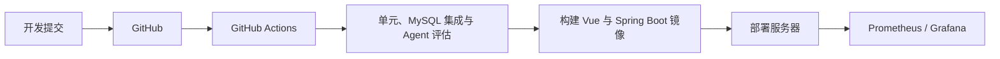

# SmartGym Copilot

> 基于 Vue 3、Spring Boot 与 Spring AI 的智能健身与健康饮食管理平台

---

## 1. 项目概述

### 1.1 项目名称

**SmartGym Copilot——基于 Agent 的智能健身与健康饮食管理平台**

### 1.2 项目定位

SmartGym Copilot 面向健身房会员、教练和运营人员，提供个性化训练计划、健康饮食建议、训练与饮食记录、知识问答、动态计划调整以及健身房运营管理功能。

本项目不是简单的大模型聊天应用，而是一个具备真实业务数据、Agent 工具调用、RAG 知识检索、用户记忆、结构化输出、安全校验和业务操作能力的完整 Agent 工程项目。

### 1.3 一句话介绍

> Vue 负责用户交互，Spring Boot 负责业务和数据安全，Spring AI 负责模型调用、工具编排、检索增强与个性化决策。

### 1.4 项目目标

该项目主要用于学习和展示以下能力：

- Vue 3 前端工程能力
- Java 后端业务系统设计能力
- Spring AI Agent 工程能力
- ChatClient、Advisor 与 Tool Calling 编排能力
- Java 状态工作流与结构化输出能力
- 基于 MySQL 的 RAG 知识库建设能力
- 基于 MySQL 的 Agent 记忆与上下文管理能力
- 大模型结构化输出与校验能力
- AI 应用安全和可观测性设计
- Docker 化部署和持续集成能力

---

## 2. 用户角色

### 2.1 会员

会员可以：

- 注册、登录和维护个人资料
- 设置增肌、减脂、塑形或维持体重等目标
- 维护身高、体重、训练经验和身体限制
- 维护饮食偏好、食物过敏和饮食限制
- 查看训练动作、器械和健身知识
- 让 Agent 生成个性化训练计划
- 记录训练重量、组数、次数和疲劳程度
- 让 Agent 根据训练表现调整后续计划
- 查询健康饮食知识
- 记录每日饮食
- 生成一天或一周的饮食计划
- 获取训练前、训练后和休息日的饮食建议
- 查看训练、体重和营养摄入趋势

### 2.2 教练

教练功能可作为增强模块，包括：

- 查看授权会员的训练情况
- 查看会员训练计划完成率
- 审核或修改 Agent 生成的训练方案
- 维护训练计划模板
- 查看异常训练反馈
- 处理会员疼痛或训练风险提示

### 2.3 管理员

管理员可以：

- 管理用户、角色和权限
- 管理训练动作和肌群
- 管理健身器械和器械状态
- 管理食物营养数据
- 管理健身和饮食知识库
- 查看会员活跃情况
- 查看 Agent 运行记录和工具调用日志
- 查看系统监控和异常信息

---

## 3. 核心业务闭环



核心价值在于形成以下闭环：

> 用户档案 → 智能计划 → 执行记录 → 数据分析 → 动态调整

---

## 4. 核心业务场景

### 4.1 智能训练计划

用户输入：

> 我想减脂，每周训练四次，每次最多 45 分钟，膝盖不太舒服。

Agent 执行：

1. 获取用户训练目标
2. 获取训练经验与身体限制
3. 获取每周可训练时间
4. 获取健身房可用器械
5. 检索候选训练动作
6. 生成结构化训练计划
7. 调用规则引擎校验训练量
8. 展示计划供用户确认
9. 用户确认后保存

### 4.2 训练计划动态调整

用户完成训练后记录：

- 每组实际重量
- 实际次数
- 完成情况
- 疲劳程度
- 疼痛位置
- 主观感受

Agent 根据最近几次训练表现判断：

- 是否需要调整训练重量
- 是否减少训练量
- 是否更换动作
- 是否延长恢复时间
- 是否调整下一阶段计划

### 4.3 健康饮食问答

用户可以询问：

- 减脂期间是否可以吃碳水？
- 今天练腿，训练前应该吃什么？
- 不吃牛肉时有哪些高蛋白食物？
- 今天的蛋白质摄入是否足够？
- 晚上聚餐，中午应该怎么安排？
- 公司食堂的菜应该怎么选？

### 4.4 自然语言饮食记录

用户输入：

> 早餐吃了两个鸡蛋、一杯牛奶和两片全麦面包。

Agent 执行：

1. 识别食物和数量
2. 搜索食物营养数据库
3. 生成候选结构化记录
4. 对不确定的份量进行标记
5. 展示给用户确认
6. 用户确认后保存
7. 更新当日营养汇总

### 4.5 训练与饮食联动

示例场景：

> 用户目标是减脂，晚上计划进行腿部训练，中午在公司食堂就餐，并且对花生过敏。

Agent 会：

1. 读取用户减脂目标
2. 获取当天腿部训练安排
3. 读取花生过敏信息
4. 排除含花生的菜品
5. 查询候选食物营养数据
6. 计算不同搭配的营养数据
7. 推荐合理的午餐组合
8. 解释训练日前不应完全避免碳水
9. 展示营养估算和数据假设
10. 用户确认后保存饮食记录

---

## 5. 总体技术架构



### 5.1 关键架构原则

#### Spring Boot 是唯一业务事实来源

用户身份、健康档案、训练计划、训练记录、饮食数据、食物营养数据、知识文档元数据、Agent 会话和审计日志均由同一个 Spring Boot 应用负责读写。MySQL 是核心业务数据库，模型只能通过受控的 Java 工具访问业务数据。

#### Spring AI 负责 AI 编排，不绕过业务层

`HealthCoachAgentService` 使用 Spring AI `ChatClient` 发起模型调用，通过 `@Tool`/`ToolCallback` 暴露只读和写入工具，写操作统一经过权限、幂等、规则校验和用户确认。模型不会直接拼接 SQL，也不会直接修改 MySQL。

#### 模型负责理解，代码负责事实

大模型负责理解用户意图、选择工具、组合候选动作或食物、生成解释；普通 Java 代码负责营养计算、训练容量计算、权限校验、参数校验、数据持久化、幂等和审计。

#### 首版采用模块化单体

前端、业务模块、Spring AI Agent、RAG 和审计能力先部署在一个可拆分的 Spring Boot 应用中。只有在调用量或团队规模确实需要时，才拆分独立服务。

## 6. 技术栈

### 6.1 前端

| 技术 | 用途 |
|---|---|
| Vue 3 | 前端核心框架 |
| TypeScript | 类型约束与工程可维护性 |
| Vite | 项目构建与开发服务器 |
| Vue Router | 页面路由 |
| Pinia | 全局状态管理 |
| Element Plus | UI 组件库 |
| Axios | REST API 请求 |
| Fetch API / SSE | Agent 流式响应 |
| ECharts | 训练、体重和营养数据图表 |
| Vitest | 单元测试 |
| Playwright | 端到端测试 |

### 6.2 Java 后端与 Spring AI

| 技术 | 用途 |
|---|---|
| Java 21 | Java 运行环境 |
| Spring Boot 3.x | 应用基础框架 |
| Spring Web | REST API 与 SSE |
| Spring Security | 认证与权限控制 |
| JWT | 用户和服务身份认证 |
| Spring Validation | 参数校验 |
| MyBatis-Plus 或 Spring Data JDBC | MySQL 数据访问 |
| MySQL 8.0+ | 唯一核心业务数据库 |
| Spring AI | ChatClient、ChatModel、EmbeddingModel、Tool Calling、Advisor、结构化输出 |
| Spring AI JDBC Chat Memory | 基于 MySQL 的会话记忆 |
| Flyway | 数据库版本管理 |
| SpringDoc OpenAPI | Swagger 接口文档 |
| Spring Boot Actuator | 健康检查和指标 |
| JUnit 5 | 单元测试 |
| Testcontainers | MySQL 集成测试 |

### 6.3 Spring AI 能力映射

| Spring AI 能力 | 本项目用途 |
|---|---|
| `ChatClient` | 统一封装对话、流式响应和模型调用 |
| `ChatModel` | 对接 OpenAI、DeepSeek、通义千问或 Ollama |
| `@Tool` / `ToolCallback` | 暴露用户档案、训练、饮食和知识检索工具 |
| `Advisor` | 会话记忆、日志、检索增强和安全前置处理 |
| `MessageChatMemoryAdvisor` | 从 MySQL 读取近期会话上下文 |
| `EmbeddingModel` | 生成知识文档和查询向量 |
| `BeanOutputConverter` 或 `.entity(...)` | 将模型输出转换为 Java DTO |
| `ChatResponse` / `Flux<ChatResponse>` | 处理模型响应和 SSE 流式输出 |

### 6.4 基础设施

| 技术 | 用途 |
|---|---|
| Docker | 应用容器化 |
| Docker Compose | 本地和演示环境编排 |
| Nginx | 反向代理和静态资源 |
| Redis（可选） | 热点缓存、限流和短期幂等状态 |
| Prometheus | 指标采集 |
| Grafana | 监控看板 |
| OpenTelemetry | 链路追踪 |
| Loki（可选） | 日志聚合 |
| GitHub Actions | 持续集成与自动部署 |
| MinIO（可选） | 图片和知识文档原文件存储 |

### 6.5 AI 模型适配

通过 Spring AI 的 `ChatModel` 与 `EmbeddingModel` 抽象适配模型供应商，业务代码只依赖 `ChatClient`：

```text
ChatModel
├── OpenAiChatModel
├── DashScopeChatModel
├── DeepSeekChatModel
└── OllamaChatModel

EmbeddingModel
├── OpenAiEmbeddingModel
├── DashScopeEmbeddingModel
└── OllamaEmbeddingModel
```

使用 `spring-ai-starter-model-*` 配置切换模型，模型名称、温度、超时和最大 Token 放在配置文件中，不散落在业务代码里。

## 7. 前端模块设计

### 7.1 会员首页

展示内容：

- 今日训练计划
- 今日饮食完成度
- 周训练完成率
- 最近体重变化
- 营养摄入趋势
- AI 快捷提问入口

### 7.2 AI 健康助理

支持：

- 流式聊天
- Agent 执行步骤展示
- 工具调用卡片
- 训练计划预览
- 饮食计划预览
- 用户确认和拒绝
- 回答来源引用
- 点赞和反馈

### 7.3 训练模块

包含：

- 训练计划列表
- 今日训练
- 动作详情
- 训练执行
- 重量、次数和组数录入
- 组间休息计时
- 疲劳和疼痛反馈
- 历史训练记录

### 7.4 饮食模块

包含：

- 饮食档案
- 食物搜索
- 饮食记录
- 每日营养汇总
- 饮食计划
- 食物替换
- 训练前后饮食建议
- 自然语言记录饮食
- 饮水记录

### 7.5 数据看板

展示：

- 体重趋势
- 训练容量趋势
- 训练完成率
- 每日热量趋势
- 蛋白质、碳水和脂肪比例
- 训练日和休息日摄入对比
- 饮食记录完整率

### 7.6 管理后台

包含：

- 用户管理
- 角色和权限管理
- 动作管理
- 器械管理
- 食物营养数据管理
- 知识库管理
- Agent 日志
- Prompt 版本管理
- 系统监控

### 7.7 推荐前端目录

```text
src/
├── api/
├── assets/
├── components/
│   ├── agent/
│   ├── workout/
│   ├── nutrition/
│   └── charts/
├── layouts/
├── router/
├── stores/
├── types/
├── utils/
└── views/
    ├── login/
    ├── dashboard/
    ├── profile/
    ├── exercises/
    ├── workout-plan/
    ├── workout-session/
    ├── nutrition/
    ├── agent-chat/
    └── admin/
```

---

## 8. Java 后端与 Spring AI 设计

### 8.1 推荐架构

第一版采用模块化单体，Spring AI 与确定性业务共用一个 Spring Boot 应用。

```text
smart-gym-server/
├── common
├── auth
├── user
├── member-profile
├── exercise
├── equipment
├── workout-plan
├── workout-session
├── nutrition-profile
├── food-catalog
├── meal-plan
├── meal-record
├── nutrition-analysis
├── knowledge
├── agent
│   ├── config
│   ├── controller
│   ├── application
│   ├── domain
│   ├── tools
│   ├── memory
│   ├── rag
│   ├── prompt
│   └── observability
├── audit
└── admin
```

### 8.2 模块内部结构

```text
workout-plan/
├── controller
├── application
├── domain
├── infrastructure
├── repository
├── entity
├── dto
└── converter
```

Agent 模块额外包含 `HealthCoachAgentService`、`AgentToolRegistry`、`AgentRunRecorder`、`SafetyAdvisor` 和 `MySqlKnowledgeRetriever`。

### 8.3 Java 后端职责

- 用户注册和登录、JWT 认证、角色与权限
- 用户健康档案、训练动作、器械、训练计划和训练记录
- 饮食档案、食物营养库、饮食计划和饮食记录
- 营养和训练数值计算、业务规则校验
- Spring AI 模型调用、工具注册、RAG 和会话记忆
- SSE 流式输出、用户确认和写操作幂等
- Agent 运行日志、工具调用审计、Prompt 版本管理

### 8.4 Agent Gateway

建议包含：

```text
AgentController
AgentConversationService
HealthCoachAgentService
AgentStreamService
AgentToolRegistry
AgentAuditService
SafetyAdvisor
```

主要职责：

- 接收会员消息并校验当前用户身份
- 使用 `ChatClient` 组装系统提示、会话记忆和业务上下文
- 注册 Spring AI 工具并驱动工具调用循环
- 将状态、工具调用、计划预览和文本内容转换为 SSE 事件
- 对写操作执行二次规则校验和用户确认
- 记录模型、工具、检索和延迟信息

### 8.5 角色设计

```text
MEMBER
TRAINER
ADMIN
AGENT_INTERNAL
```

`AGENT_INTERNAL` 是应用内部的逻辑身份，用于区分模型发起的工具调用和普通用户请求；实际权限仍以当前登录用户和工具白名单为准。

## 9. Spring AI Agent 设计

### 9.1 Agent 定位

第一版构建一个统一的：

> Health Coach Agent

它由 `HealthCoachAgentService` 编排训练和饮食子流程，使用 Spring AI 的 `ChatClient`、Tools、Advisors 和结构化输出能力。

```text
Health Coach Agent
├── 健身知识问答
├── 训练计划生成
├── 训练计划调整
├── 健康饮食问答
├── 饮食记录解析
├── 饮食计划生成
├── 每日营养分析
└── 训练与饮食联合建议
```

### 9.2 为什么不一开始使用多 Agent

第一版不建议直接实现多个自治 Agent，因为系统复杂度、调试成本、延迟和评估难度都会增加。先使用一个状态清晰、工具受控、可审计的 Java 编排器；当训练和饮食流程边界稳定后，再将其拆为多个 `ChatClient` 或独立 Advisor。

增强版可以拆分为：

```text
Health Supervisor
├── Fitness Coach ChatClient
├── Nutrition Coach ChatClient
└── Safety Reviewer Advisor
```

### 9.3 Agent 状态示例

```java
public record HealthCoachContext(
    Long userId,
    String conversationId,
    String intent,
    UserProfile profile,
    FitnessProfile fitnessProfile,
    NutritionProfile nutritionProfile,
    List<String> allergies,
    List<String> dietaryRestrictions,
    WorkoutPlan currentWorkoutPlan,
    List<WorkoutRecord> recentWorkouts,
    List<MealRecord> recentMeals,
    NutritionTarget nutritionTarget,
    List<Exercise> availableExercises,
    List<KnowledgeChunk> retrievedKnowledge,
    WorkoutPlanDraft workoutDraft,
    MealPlanDraft mealDraft,
    List<String> safetyFlags,
    List<String> validationErrors,
    boolean requiresConfirmation,
    String finalAnswer
) {}
```

状态保存在一次请求的 Java 上下文中，跨请求的会话消息和长期偏好保存在 MySQL。

## 10. Spring AI Agent 工作流

### 10.1 通用工作流



编排器以显式 Java 服务方法表示节点和状态，不依赖外部 Agent 服务或额外图编排框架；Spring AI 负责模型调用和工具编排。模型调用只发生在需要理解、生成或解释的节点；计算、查询和持久化始终由 Java 服务完成。

### 10.2 训练计划工作流

```text
读取用户训练目标
  ↓
调用用户档案和身体限制工具
  ↓
获取每周可训练时间与可用器械
  ↓
检索 MySQL 中的候选动作和注意事项
  ↓
ChatClient 输出 WorkoutPlanDraft
  ↓
Java 规则服务校验训练量、疼痛和器械约束
  ↓
SSE 返回计划预览
  ↓
用户确认后保存训练计划
```

### 10.3 饮食计划工作流

```text
读取饮食目标
  ↓
获取饮食偏好、过敏原和限制
  ↓
获取当天训练安排
  ↓
Java 计算营养目标范围
  ↓
MySQL 检索候选食物
  ↓
ChatClient 输出 MealPlanDraft
  ↓
Java 重新计算营养总量并校验过敏原
  ↓
用户确认后保存饮食计划
```

## 11. Spring AI Tools

### 11.1 工具注册方式

使用 Spring AI 的 `@Tool` 方法或 `ToolCallback` 注册工具。工具方法位于 Java 应用内部，直接调用领域服务和 Repository，不向模型暴露 SQL、实体内部字段或管理员接口。

```java
@Component
public class WorkoutTools {
    private final WorkoutQueryService workoutQueryService;

    @Tool(description = "查询用户最近指定天数的训练记录")
    public List<WorkoutRecordView> getRecentWorkouts(Long userId, int days) {
        return workoutQueryService.findRecent(userId, days);
    }

    @Tool(description = "校验候选训练计划是否符合训练量、时间和安全规则")
    public PlanValidationResult validateTrainingPlan(WorkoutPlanDraft draft) {
        return workoutQueryService.validateDraft(draft);
    }
}
```

### 11.2 用户档案工具

```text
getUserProfile(userId)
getFitnessProfile(userId)
getNutritionProfile(userId)
getHealthConstraints(userId)
getFoodAllergies(userId)
getFoodPreferences(userId)
```

### 11.3 训练工具

```text
getRecentWorkouts(userId, days)
getCurrentTrainingPlan(userId)
getTodayWorkout(userId)
calculateWeeklyTrainingVolume(userId)
searchExercises(muscleGroup, equipment)
getExerciseDetail(exerciseId)
listAvailableEquipment(gymId)
validateTrainingPlan(plan)
saveTrainingPlanAfterConfirmation(userId, plan, idempotencyKey)
updateTrainingPlanAfterConfirmation(planId, changes, idempotencyKey)
```

### 11.4 饮食工具

```text
searchFoods(keyword)
getFoodNutrition(foodId)
getDailyMealRecords(userId, date)
getRecentMealRecords(userId, days)
calculateMealNutrition(items)
calculateDailyNutrition(userId, date)
validateMealPlan(plan)
saveMealPlanAfterConfirmation(userId, plan, idempotencyKey)
createMealRecordAfterConfirmation(userId, meal, idempotencyKey)
replaceMealItem(planId, itemId, constraints)
```

### 11.5 知识库工具

```text
searchFitnessKnowledge(query, filters)
searchNutritionKnowledge(query, filters)
searchEquipmentManual(query, filters)
searchExercisePrecautions(query, filters)
```

### 11.6 系统工具

```text
requestUserConfirmation(content)
createSafetyAlert(userId, reason)
recordAgentFeedback(conversationId, rating)
```

### 11.7 修改类工具的工程要求

所有写操作工具都应具备参数校验、当前用户权限校验、工具白名单、幂等键、操作审计、超时处理、重试限制、最大调用次数和失败补偿。写工具只在用户确认事件或明确的低风险操作下执行。

## 12. 结构化输出设计

### 12.1 Java DTO 与模型输出

使用 Java `record`/Bean 定义模型输出，并通过 Spring AI `.entity(...)` 或 `BeanOutputConverter` 转换；转换失败时不落库，交给校验和重试流程处理。

```java
public record WorkoutPlanDraft(
    String planName,
    int durationWeeks,
    int trainingDaysPerWeek,
    List<WorkoutDayDraft> days,
    List<String> warnings
) {}

public record MealPlanDraft(
    String planName,
    LocalDate date,
    String goal,
    NutritionTarget estimatedTargets,
    List<MealDraft> meals,
    List<String> warnings,
    List<String> assumptions
) {}
```

调用示例：

```java
WorkoutPlanDraft draft = chatClient.prompt()
    .system(workoutSystemPrompt)
    .user(userMessage)
    .tools(workoutTools)
    .call()
    .entity(WorkoutPlanDraft.class);
```

### 12.2 饮食计划示例

```json
{
  "planName": "增肌训练日饮食计划",
  "date": "2026-08-03",
  "goal": "muscle_gain",
  "estimatedTargets": {
    "calories": 2400,
    "protein": 150,
    "carbohydrate": 280,
    "fat": 75
  },
  "meals": [
    {
      "mealType": "breakfast",
      "time": "08:00",
      "items": [
        {"foodId": 101, "foodName": "燕麦", "amount": 60, "unit": "g"},
        {"foodId": 205, "foodName": "牛奶", "amount": 250, "unit": "ml"}
      ],
      "estimatedNutrition": {
        "calories": 410,
        "protein": 18,
        "carbohydrate": 58,
        "fat": 12
      }
    }
  ],
  "warnings": [],
  "assumptions": ["食物重量按照可食用部分估算", "未包含额外烹饪油脂"]
}
```

### 12.3 双重校验

- Spring AI 将模型响应转换为 Java DTO，并校验必填字段、枚举和数值范围
- Java 业务规则再次校验训练量、时长、营养总量、过敏原和器械约束
- 用户确认后才能保存正式计划
- 所有模型原始响应只进入脱敏审计日志，不直接作为业务事实

## 13. 基于 MySQL 的 RAG 知识库

### 13.1 知识范围

- 动作说明、目标肌群和常见错误
- 器械使用说明、热身和恢复知识
- 基础营养、训练前后饮食和过敏原信息
- 系统维护的安全提示和免责声明

### 13.2 RAG 流程



首版统一使用 MySQL：知识文档和分块使用普通字段管理，关键词检索使用 `FULLTEXT`，语义向量以 JSON/BLOB 保存并由 Java 检索器计算相似度。若部署环境提供 MySQL HeatWave 或兼容向量索引，只替换 `KnowledgeRetriever` 实现，业务接口不变。

### 13.3 Spring AI 检索适配

实现 `KnowledgeRetriever` 领域接口，在内部调用 Spring AI `EmbeddingModel`，返回 `Document`/`KnowledgeChunk`，再交给自定义 `Advisor` 或 `@Tool` 注入上下文。这样可以保留 Spring AI 的模型抽象，同时避免引入第二套向量数据库。

### 13.4 业务数据与知识数据边界

确定性业务数据直接查询 MySQL：食物营养、用户体重、训练记录和器械状态。解释性内容使用 RAG：动作原因、碳水安排、器械注意事项和常见训练错误。回答必须携带文档标题、版本和来源时间。

## 14. 记忆设计

### 14.1 短期记忆

使用 Spring AI `MessageChatMemoryAdvisor` 配合 JDBC Chat Memory Repository，将当前会话的消息、工具结果摘要和待确认草稿保存到 MySQL。每次请求只加载最近窗口，避免上下文无限增长。

### 14.2 长期偏好记忆

稳定偏好保存到 `agent_memory`，由 Java 服务负责去重、置信度和来源管理：

```json
{
  "preferenceType": "exercise_preference",
  "key": "barbell_squat",
  "value": "avoid",
  "source": "explicit_user_statement",
  "confidence": 1.0
}
```

模型可以提出记忆候选，但只有显式用户表达或用户确认后才写入长期偏好。

### 14.3 业务事实

以下信息必须保存到 MySQL 业务表，不能只存在于 Agent 记忆：身高和体重、训练计划、饮食计划、训练记录、饮食记录、食物过敏和健康限制。

## 15. MySQL 数据库设计

### 15.1 用户领域

```text
sys_user
sys_role
sys_user_role
member_profile
body_metric
health_constraint
training_goal
```

### 15.2 训练领域

```text
exercise
muscle_group
exercise_muscle
 equipment
gym_equipment
exercise_equipment
workout_plan
workout_plan_day
workout_plan_exercise
workout_session
workout_set_record
workout_feedback
```

### 15.3 饮食领域

```text
nutrition_profile
food_preference
food_allergy
dietary_restriction
nutrition_target
food
food_category
food_nutrition
food_serving
food_allergen
recipe
recipe_ingredient
meal_plan
meal_plan_day
meal_plan_meal
meal_plan_item
meal_record
meal_record_item
daily_nutrition_summary
water_record
```

### 15.4 知识库领域

```text
knowledge_document
knowledge_chunk
knowledge_source
```

`knowledge_chunk` 保存 `content`、`content_hash`、`embedding_json`、`document_type`、`version`、`metadata_json`、`fulltext` 和更新时间；通过 `FULLTEXT` 索引支持关键词召回。

### 15.5 Agent 领域

```text
agent_conversation
agent_message
agent_run
agent_step
agent_tool_call
agent_feedback
agent_memory
prompt_version
chat_memory_message
```

### 15.6 关键表字段

#### agent_tool_call

```text
id
agent_run_id
tool_name
request_json
response_json
status
duration_ms
error_message
created_at
```

#### prompt_version

```text
id
prompt_name
version
content
model_name
temperature
enabled
created_at
```

#### food_nutrition

```text
id
food_id
serving_amount
serving_unit
calories
protein
carbohydrate
fat
fiber
sodium
sugar
source
source_version
updated_at
```

#### meal_record_item

```text
id
meal_record_id
food_id
food_name_snapshot
amount
unit
estimated_calories
estimated_protein
estimated_carbohydrate
estimated_fat
input_source
confidence
confirmed_by_user
```

历史饮食记录保存营养快照，避免食物库更新后历史数据发生变化。所有 Agent 表使用 `user_id`、`conversation_id` 或 `agent_run_id` 建立审计关联，并按租户/用户权限查询。

## 16. API 设计

### 16.1 前端调用 Spring Boot

```http
POST /api/v1/agent/conversations/{conversationId}/messages
Authorization: Bearer <user-token>
Content-Type: application/json

{
  "content": "帮我制定今天的训练和饮食方案"
}
```

### 16.2 SSE 流式响应

```text
event: status
data: {"node":"load_profile","message":"正在读取健康档案"}

event: tool_call
data: {"tool":"getTodayWorkout","status":"running"}

event: tool_call
data: {"tool":"calculateDailyNutrition","status":"success"}

event: plan_preview
data: {"workoutPlan":{},"mealPlan":{}}

event: token
data: {"content":"根据你今天的训练安排..."}
event: done
data: {"runId":"run-10001"}
```

控制器返回 `Flux<ServerSentEvent<AgentEvent>>`，由 `AgentStreamService` 将 `ChatClient.stream()`、工具事件和业务事件统一转换为前端协议。

### 16.3 工具调用边界

工具不再通过 Java HTTP 接口暴露，而是通过 Spring AI `ToolCallback` 在同一 Spring Boot 进程内调用领域服务。对于未来拆分服务的场景，再将同一套工具接口封装为受保护的内部 REST API。

### 16.4 写操作请求

```http
POST /api/v1/agent/runs/{runId}/confirm
Authorization: Bearer <user-token>
Idempotency-Key: <uuid>
Content-Type: application/json

{"draftType":"workout_and_meal_plan","accepted":true}
```

确认接口必须重新加载草稿、执行权限和业务规则校验，再在一个事务中保存计划和审计记录。

## 17. 安全设计

### 17.1 Agent 不允许执行的行为

- 诊断疾病
- 替代医生或注册营养师
- 制定疾病治疗方案
- 推荐极端节食
- 鼓励长期断食
- 忽略食物过敏
- 在严重疼痛时继续生成训练计划
- 修改其他用户的数据
- 未经确认执行高风险写操作

### 17.2 风险分级

```text
LOW
普通健身和健康饮食问题，可以正常回答。

MEDIUM
存在慢性疾病、孕期或特殊身体情况，只提供一般信息，
并建议咨询医生、营养师或其他专业人员。

HIGH
出现胸痛、昏厥、呼吸困难、严重疼痛、
进食障碍或极端减重要求时，
停止生成具体计划并提示寻求专业帮助。
```

### 17.3 工程防护

- 工具白名单
- 工具参数校验
- 用户权限校验
- 服务身份认证
- 幂等控制
- 工具调用超时
- 最大循环次数
- 模型结构化输出校验
- 计划保存前二次校验
- 用户确认机制
- 操作审计
- Prompt 注入防护
- 知识文档来源与版本管理

### 17.4 产品免责声明

> 本系统提供一般性的健身和健康饮食信息，不能替代医生、注册营养师或其他专业人员的诊断、治疗或个性化医疗建议。

---

## 18. 可观测性

### 18.1 系统指标

- Agent 请求数量、成功率和平均响应时间
- 首 Token 时间、完整响应时间和流式中断率
- ChatModel 调用次数、Token 使用量和异常率
- ToolCallback 调用次数、成功率、耗时和重试次数
- MySQL 检索耗时、Embedding 耗时和 RAG 命中率
- 训练/饮食计划校验失败率
- 用户计划确认率和反馈分数

### 18.2 链路追踪

每次 Agent 运行生成 `runId`，并通过 MDC、OpenTelemetry 和 SSE 事件贯穿：

```text
Vue 请求
  → AgentController
  → HealthCoachAgentService
  → ChatClient / ChatModel
  → ToolCallback
  → 领域服务
  → MySQL
```

### 18.3 日志与监控

使用 Spring Boot Actuator、Micrometer、Prometheus、Grafana 和 OpenTelemetry。模型请求日志默认脱敏，用户健康数据和完整 Prompt 不直接写入普通应用日志。

## 19. Agent 评估体系

### 19.1 测试案例

建议准备 30～50 个固定案例：初学者每周训练三次、减脂、只有哑铃、膝盖不适、花生过敏、每次只能训练 45 分钟、食堂菜品组合、极端节食、提示注入、越权修改、份量不明确和器械不可用。

### 19.2 评估指标

```text
Intent Accuracy
Tool Selection Accuracy
Plan DTO Validity
Business Validation Pass Rate
RAG Retrieval Relevance
Allergen Miss Rate
Safety Violation Rate
Hallucination Rate
Average Latency
User Confirmation Rate
```

### 19.3 评估实现

评估数据使用 JSONL 保存，由 JUnit 5 或独立的 `agent-evaluation` Java 模块调用 `HealthCoachAgentService`，使用 Testcontainers 启动 MySQL，固定模型响应或接入评测模型后输出报告。

```bash
./mvnw -pl agent-evaluation test
```

实际简历中只能填写真实测试结果。

## 20. 部署架构

### 20.1 Docker Compose 服务

```text
nginx
vue-web
smart-gym-server
mysql
redis（可选）
minio（可选）
prometheus
grafana
```

Spring Boot 应用同时承载业务 API、Spring AI Agent、RAG 检索和 SSE。MySQL 是唯一核心数据库，Redis 只作为可选缓存和限流组件。

### 20.2 推荐部署流程



### 20.3 配置原则

模型 API Key、MySQL 密码、JWT 密钥和管理凭据通过环境变量或密钥管理系统注入；不同环境只替换配置，不修改业务代码。

## 21. 开发阶段

### 第一阶段：基础业务系统

完成用户登录与权限、健康档案、动作与器械管理、训练计划 CRUD、训练记录、饮食档案、食物营养库、饮食记录、每日营养汇总、Flyway 迁移和 Docker Compose MySQL 环境。

目标：在没有 AI 的情况下，系统也可以正常使用。

### 第二阶段：Spring AI Agent MVP

完成 `ChatClient` 配置、模型适配、`@Tool` 工具注册、Spring AI Agent 编排器、用户档案工具、训练计划生成、健康饮食问答、自然语言饮食记录、DTO 结构化输出、SSE 流式响应和用户确认机制。

### 第三阶段：MySQL RAG 与记忆

完成知识文档导入、EmbeddingModel、MySQL FULLTEXT + 向量混合检索、来源引用、`MessageChatMemoryAdvisor`、长期偏好记忆和 Prompt 版本管理。

### 第四阶段：训练与饮食联动

完成训练日和休息日饮食建议、训练前后饮食推荐、根据训练完成情况调整建议、食堂菜单选择、食物替换和联合健康计划。

### 第五阶段：工程化增强

完成 Agent 调用日志、工具审计、限流、重试、熔断、Prometheus 与 Grafana、单元测试、MySQL 集成测试、Agent 离线评估、GitHub Actions 和 Docker 部署。

## 22. 项目范围控制

### 22.1 必须完成

- 用户登录与权限
- 用户健康档案
- 动作与器械管理
- 训练计划和训练记录
- 饮食档案和食物库
- 饮食记录和营养汇总
- Health Coach Agent
- 训练计划生成
- 健康饮食问答
- 自然语言饮食记录
- Tool Calling
- SSE 流式输出
- 用户确认
- 安全规则
- Docker 部署

### 22.2 推荐完成

- RAG 知识库
- 用户偏好记忆
- 训练饮食联动
- 食物替换
- 食堂菜单选择
- Agent 运行日志
- Prompt 版本管理
- Agent 离线评估

### 22.3 未来规划

- 多 Agent 协作
- 摄像头动作识别
- 食物图片识别
- 智能手环数据接入
- 健身器械 IoT
- 微信小程序
- 教练工作台
- 外卖平台菜单分析

---

## 23. 推荐演示流程

用户档案：

```text
目标：减脂
训练频率：每周四次
今日训练：腿部训练
饮食场景：公司食堂
过敏信息：花生过敏
可训练时间：45 分钟
```

用户询问：

> 今天晚上练腿，中午食堂有米饭、鸡腿、鱼、青菜、花生拌菜和炸鸡，我应该怎么选？晚上训练也只有 45 分钟。

Agent 执行：

1. 读取用户目标
2. 读取过敏信息
3. 获取当天训练计划
4. 获取最近训练记录
5. 排除花生相关菜品
6. 查询候选食物营养数据
7. 计算午餐组合
8. 查询可用训练器械
9. 生成 45 分钟腿部训练方案
10. 后端校验训练与饮食方案
11. 展示方案和工具调用过程
12. 用户确认
13. 保存训练和饮食计划
14. 后续根据实际完成情况动态调整

该演示可以同时体现：

- Agent 编排
- Tool Calling
- 训练与饮食联动
- 过敏原检查
- 业务规则校验
- 结构化输出
- Human-in-the-loop
- 数据持久化
- SSE 流式交互

---

## 24. 简历项目描述

### 项目名称

**SmartGym Copilot——基于 Spring AI 的智能健身与健康饮食管理平台**

### 项目简介

基于 Vue 3、Java 21、Spring Boot、Spring AI 和 MySQL 构建智能健身与健康饮食管理平台，为会员提供个性化训练计划、饮食建议、执行记录、动态调整和健身知识问答。

### 简历亮点

- 使用 Spring AI `ChatClient`、`Advisor` 和 `ToolCallback` 构建有状态 Health Coach Agent，将意图识别、用户上下文加载、MySQL 知识检索、工具调用、安全检查、计划生成和用户确认编排为可追踪工作流。
- 设计 Java 模块化单体架构，模型只能通过 `@Tool` 调用用户档案、训练、饮食和营养计算服务，避免模型直接访问核心数据库。
- 实现训练计划与饮食建议联动，根据用户目标、训练安排、身体限制、饮食偏好和食物过敏信息生成个性化方案。
- 基于 MySQL FULLTEXT 与 EmbeddingModel 实现混合 RAG，使用 MySQL 管理知识文档、向量和版本元数据，支持来源引用。
- 使用 Spring AI 结构化输出将模型结果转换为 Java DTO，并由后端二次校验训练量、营养数据、器械和过敏原约束。
- 通过 Spring WebFlux/Flux SSE 实现 Agent 状态、工具调用、计划预览和自然语言回答的流式展示。
- 设计 Agent 运行日志、工具调用审计、Prompt 版本管理和离线评估集，覆盖工具选择、结构化输出、过敏原检查和安全规则等指标。
- 使用 Docker Compose、MySQL、Prometheus、Grafana 和 GitHub Actions 完成服务部署、指标监控和持续集成。

## 25. 最终技术方案

```text
Frontend
Vue 3 + TypeScript + Vite
Pinia + Vue Router + Element Plus
Axios + ECharts + SSE

Java Business and AI Backend
Java 21 + Spring Boot 3.x
Spring Web + Spring Security + JWT
MyBatis-Plus / Spring Data JDBC + MySQL 8.0+
Spring AI ChatClient + ChatModel + EmbeddingModel
Spring AI Tools + Advisors + Structured Output
Spring AI JDBC Chat Memory
Flyway + Actuator + OpenAPI

RAG and Memory
MySQL FULLTEXT + embedding_json
KnowledgeRetriever + custom RAG Advisor
MySQL conversation memory and preference memory

Infrastructure
Docker Compose + Nginx
Redis（可选）+ MinIO（可选）
Prometheus + Grafana
OpenTelemetry + GitHub Actions
```

## 26. 项目总结

SmartGym Copilot 的合理定位是：

> 一个以 Java 业务系统和 MySQL 为基础、由 Spring AI 驱动智能决策、通过 Vue 展示完整交互的训练与饮食一体化健康管理平台。

项目的核心不是让大模型简单回答“怎么练、怎么吃”，而是让 Spring AI Agent 完成：

```text
读取真实用户数据
  → 通过 ToolCallback 调用受控业务工具
  → 查询 MySQL 中的可靠知识和营养数据
  → 生成 Java 结构化方案
  → 执行业务规则校验
  → 请求用户确认
  → 保存正式记录
  → 根据执行情况持续调整
```

这个项目能够展示：

- Vue 与 Java 全栈开发能力
- Spring Boot 模块化业务系统设计能力
- Spring AI ChatClient、Tool Calling、Advisor 和结构化输出能力
- MySQL 业务数据、记忆和 RAG 知识库设计能力
- 安全、审计、可观测性和部署能力
- 将大模型能力落地到真实业务系统的综合能力
